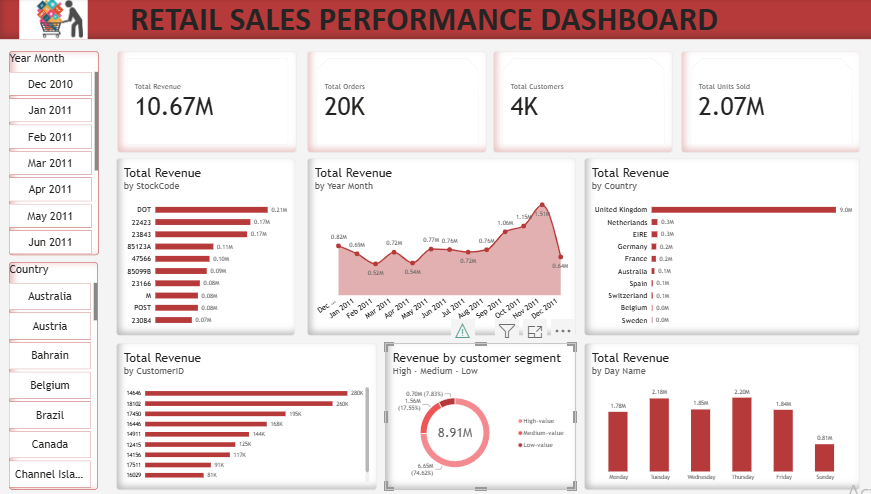

# UK Online Retail Sales & Customer Performance Analysis

[](#)
[](#)
[](#)

An end-to-end transactional data analytics project evaluating 12 months of sales records from a UK-based online retailer. Built with PostgreSQL for data profiling, anomaly isolation, and business aggregation, alongside an interactive Power BI dashboard for visual reporting and customer segmentation.

---

##  Dashboard Preview



> **Repository Artifacts:** Inspect SQL pipeline scripts in [`sql/`](sql/) or view the dataset documentation in [`data/README.md`](data/README.md).

---

##  Executive Summary & Core KPIs

The analysis evaluates transactional data from **December 1, 2010 to December 9, 2011**, applying defensible positive-sales criteria (`Quantity > 0`, `UnitPrice > 0`, non-cancellation records).

| Metric | Analyzed Value | Analytical Context |
| :--- | :--- | :--- |
| **Gross Positive Revenue** | **£10,670,000+** (£10.67M) | Total positive merchandise & service transactions |
| **Analyzed Clean Records** | **530,100 lines** | Excludes cancellations (`InvoiceNo` starting with 'C') and zero/negative prices |
| **Peak Sales Month** | **November 2011** (~£1.51M) | Strong seasonal surge leading into Q4 holidays |
| **Lowest Full Month** | **February 2011** (~£523.6K) | Post-holiday demand contraction |
| **Dominant Market** | **United Kingdom** | Generates the majority of overall revenue |
| **Highest-Value Customer** | **Customer ID 14646** (~£280.2K) | Top identifiable wholesale/high-volume buyer |
| **Top Merchandise Product** | **StockCode 22423** (~£174.5K) | Highest revenue driver after filtering non-merchandise fees |

---

## 💼 Business Problem & Analytical Objectives

The retailer recorded roughly one year of transactional data across multiple global markets without structured KPI tracking or customer behavior segmentation. 

This project answers eight primary business questions:
1. **Revenue Growth:** How much revenue was generated, and how did volume trend over time?
2. **Product Volume:** Which products have the highest and lowest unit sales volumes?
3. **Geographic Distribution:** Which countries have the highest concentration of customers and revenue?
4. **Sales Timing:** When do sales peak by month, day of week, and hour of the day?
5. **Product Revenue:** Which specific items generate the highest total revenue?
6. **Customer Concentration:** Which customer accounts drive the largest revenue share?
7. **Customer Inactivity:** Which customer accounts have become inactive under a defined benchmark?
8. **High-Value Product Mix:** What items do top-tier revenue customers purchase most frequently?

---

## Tools & Technologies

| Tool | Purpose in Project |
| :--- | :--- |
| **PostgreSQL** | Exploratory data queries, auditing anomalies, validation, and multi-table business aggregations |
| **Power BI Desktop** | Dimensional modeling, DAX measure engineering, customer tier segmentation, and visualization |
| **Power Query** | ETL pipeline transformations and parameter configuration |
| **Git & GitHub** | Atomic version control, workflow commits, and documentation |

---

## Data Quality Audit & Cleaning Decisions

The raw dataset (541,909 rows) was audited thoroughly to ensure transparent analytical boundaries without silently deleting business information:

```text
Raw Transaction Data (541,909 records)
       │
       ├── Anomaly Audits: Negative quantities, cancelled invoices ('C%'), zero unit prices
       │
       ▼
Positive Sales Subset (530,100 records)
       │── Filter rules: Quantity > 0 AND UnitPrice > 0 AND InvoiceNo NOT LIKE 'C%'
       │
       ├── Missing Customer IDs: Retained for gross sales; excluded only from customer profiling
       ├── Duplicate Line Items: Retained due to insufficient context to disprove legitimate re-orders
       └── Outliers & Adjustments: Isolated manual fees (e.g., POST, DOT) from physical merchandise
```

## Data Quality Findings

- **Cancellations vs. Negative Quantities:** Cross-referencing `InvoiceNo NOT LIKE 'C%'` against `Quantity > 0` confirmed the exact same subset of 530,100 valid positive rows.
- **Missing Identifiers:** Records lacking a `CustomerID` were retained for store-level sales and revenue totals, but isolated when analyzing customer lifetime purchasing habits.
- **Transaction Reversals:** `StockCode 23843` showed massive positive volume but was identified during exploration as an unusual administrative reversal, warranting separation from core merchandise evaluations.

## 📈 Key Findings

### 1. Revenue & Seasonality Trends
- Revenue accelerated substantially into the fourth quarter of 2011, peaking in November 2011 at £1.51M.
- The slowest trading month was February 2011 (£523,631.89).

### 2. Geographic & Customer Concentration
- While the United Kingdom represents the dominant customer base and volume source, the Netherlands produced £285,446.34 with only nine registered customer accounts, demonstrating significant wholesale demand.
- Customer 14646 alone contributed £280,206.02, illustrating that institutional/wholesale buyers carry disproportionate operational value compared to retail consumers.

### 3. Timing & Operational Windows
- **Peak Days:** Thursday (£2.20M) and Tuesday (£2.18M) generated the highest cumulative revenue.
- **Peak Hours:** Transactions concentrate during daytime business hours (10:00 to 15:00), with peak hourly sales at 10:00 (£1.45M).

### 4. Product Insights
- `StockCode 22423` (Regency Cakestand 3 Tier) generated £174,484.74, making it the single largest positive physical merchandise revenue generator.
- At the bottom of active positive listings, `StockCode 84227` generated only £0.42.

## 📋 SQL Script Pipeline

The analytical SQL workflow is separated into five sequential modules:

| Script | Analytical Scope | Key Techniques |
|---|---|---|
| `01_data_exploration.sql` | Initial profiling, range verification, and null audits | `COUNT`, `DISTINCT`, date range boundaries |
| `02_data_cleaning.sql` | Investigating negative quantities, cancellations, zero prices | `CASE`, conditional filtering, anomaly identification |
| `03_kpi_analysis.sql` | Revenue totals, monthly run rates, day/hour breakdowns | `DATE_PART`, `EXTRACT`, window aggregations |
| `04_customer_analysis.sql` | High-value customer ranks and 90-day inactivity classification | `DATEDIFF` equivalents, customer grouping, RFM framing |
| `05_product_analysis.sql` | Unit volume rankings, revenue per item, outlier detection | `SUM`, `ORDER BY`, merchandise categorization |

##  Analytical Assumptions & Limitations

- **Gross Positive Sales Focus:** Performance calculations prioritize positive sales transactions and do not calculate net returns or cancellation refunds.
- **Inactivity Classification:** The 90-day benchmark tags accounts with no purchases in the final 90 days of the dataset as inactive; this is an analytical operational classification, not definitive customer churn.
- **Historical Horizon:** Transactions reflect 2010–2011 wholesale and retail conditions and should not be inferred as modern e-commerce consumer behavior.

## Repository Structure
```text
Retail-Sales-Analysis/
├── README.md                      # Executive overview, methodology, and key findings
├── data/
│   └── README.md                  # UCI source link, column definitions, and schema details
├── sql/
│   ├── 01_data_exploration.sql    # Data quality profiling and row counts
│   ├── 02_data_cleaning.sql       # Cleaning validations and exclusion rules
│   ├── 03_kpi_analysis.sql        # Revenue and temporal sales aggregations
│   ├── 04_customer_analysis.sql   # Customer spend and inactivity analysis
│   └── 05_product_analysis.sql    # Product volume and sales revenue queries
└── images/
    └── dashboard.png              # Power BI report screenshot
```

## 👤 Author

**Muna Mohammed Husen**
Undergraduate Data Science Student | Aspiring Data & BI Analyst

- **Core Competencies:** SQL (PostgreSQL), Data Auditing & Cleaning, KPI Development, Power BI, Analytical Documentation